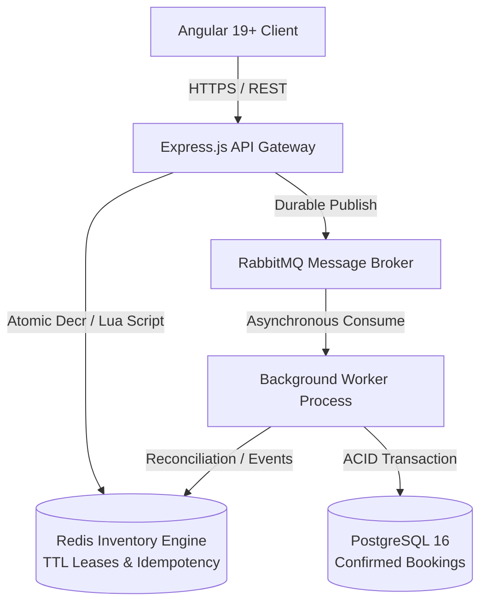

# 🛡️ DropShield

> **DropShield** is a distributed, high-concurrency event ticket booking platform designed to withstand flash-crowd demand spikes (e.g., stadium-scale concert ticket drops) without overselling, race conditions, or database degradation.

---

## 🏗️ Architecture Overview

DropShield adopts a high-throughput, memory-first architecture with asynchronous persistence:



### Architectural Principles
- **Fast-Path Memory Allocation**: High-concurrency ticket reservations are acquired atomically in Redis via Lua scripts, bypassing relational database locking during peak traffic.
- **Asynchronous Order Processing**: RabbitMQ buffers requests to ensure predictable, level load on PostgreSQL.
- **Zero-Overselling Guarantee**: Enforced by atomic inventory decrements, monotonic sequence checks, and strict database constraints.
- **Idempotency**: Requests carry idempotency keys ensuring at-most-once reservation semantics even under network retries.

---

## 🛠️ Technology Stack

| Layer | Technology | Purpose |
| :--- | :--- | :--- |
| **Frontend** | Angular 19+, TypeScript, RxJS | Reactive, high-performance user booking interface |
| **Styling** | Tailwind CSS | Modern, utility-first responsive styling |
| **Backend API** | Node.js, Express.js, TypeScript | High-throughput REST API gateway |
| **Validation** | Zod | Runtime environment variable and schema validation |
| **Database** | PostgreSQL 16 (`pg` driver) | ACID persistent storage for finalized bookings and events |
| **Cache & Locks** | Redis 7 + Lua Scripts | Atomic inventory engine, distributed locks, TTL leases |
| **Message Broker**| RabbitMQ 3.13 | Durable, reliable asynchronous message queue |
| **Testing** | Jest, Supertest, k6 | Unit, integration, and high-concurrency load testing |
| **Infrastructure**| Docker, Docker Compose | Containerized local and production runtime |

---

## 📂 Repository Structure

DropShield is organized as an **npm workspaces monorepo**:

```
DropShield/
|-- frontend/                 # Angular 19+ Single Page Application
|   |-- src/                  # App components, styles, environments
|   |-- angular.json          # Angular CLI workspace configuration
|   |-- package.json          # Frontend dependencies & scripts
|   |-- tsconfig.json         # Strict TypeScript compiler options
|
|-- backend/                  # Node.js + Express API & Background Worker
|   |-- src/
|   |   |-- config/           # Zod environment validation & runtime config
|   |   |-- middleware/       # Error handling, logging, rate limiting
|   |   |-- routes/           # REST endpoints (e.g. /health)
|   |   |-- services/         # Domain business logic (Phase 4 & 5)
|   |   |-- queues/           # RabbitMQ publishers & consumers (Phase 5)
|   |   |-- utils/            # Structured logging and utilities
|   |   |-- app.ts            # Express application factory
|   |   |-- server.ts         # API Server entry point
|   |   |-- worker.ts         # Background Worker entry point
|   |-- tests/                # Jest & Supertest integration tests
|   |-- package.json          # Backend dependencies & scripts
|   |-- tsconfig.json         # Strict TypeScript configuration
|
|-- shared/                   # Cross-workspace TypeScript contracts
|   |-- src/                  # Shared domain types, contracts & constants
|   |-- types/                # Type definitions
|   |-- package.json          # Workspace package configuration
|   |-- tsconfig.json         # Declaration and compiler settings
|
|-- database/                 # Database schema evolution (Phase 3)
|   |-- migrations/           # SQL migration scripts
|   |-- seeds/                # Seed data for development and testing
|
|-- infrastructure/           # Docker and deployment configurations
|   |-- docker/               # Service Dockerfiles
|
|-- scripts/                  # Development and CI/CD utility scripts
|-- docs/                     # Architectural documents & design specs
|-- docker-compose.yml        # Multi-container orchestration (Phase 2)
|-- package.json              # Monorepo root workspace manifest
|-- .gitignore                # Git ignore rules (secrets, dist, node_modules)
|-- .env.example              # Documented environment template
|-- .editorconfig             # Consistent editor formatting rules
|-- README.md                 # Project documentation
```

---

## 🗺️ Development Roadmap

- [x] **Phase 01: Repository & Monorepo Setup** (Workspace, Angular 19, Express, TypeScript, Git configuration)
- [ ] **Phase 02: Infrastructure Setup** (PostgreSQL, Redis, RabbitMQ, Docker Compose)
- [ ] **Phase 03: Database Engineering** (Migrations, schema, indexes, transactional constraints)
- [ ] **Phase 04: Redis Inventory Engine** (Lua scripts, atomic reservations, TTL and idempotency)
- [ ] **Phase 05: Backend Processing** (API intake, RabbitMQ, background workers)
- [ ] **Phase 06: Authentication & Frontend** (RBAC, JWT cookies, Angular booking interface)
- [ ] **Phase 07: Reliability Engineering** (Retries, recovery, failure injection and reconciliation)
- [ ] **Phase 08: Performance Engineering** (k6, 10K+ RPS experiments, Prometheus and Grafana)

---

## 🚀 Getting Started

### Prerequisites
- **Node.js**: `v20.11.0` or higher (Active LTS recommended)
- **npm**: `v10.0.0` or higher
- **Docker & Docker Compose**: (Required for Phase 2+)

### Installation
Clone the repository and install all monorepo dependencies:

```bash
# Clone the repository
git clone https://github.com/SurajMnnit/DropShield.git
cd DropShield

# Install dependencies across all workspaces
npm install
```

### Environment Configuration
Copy `.env.example` to `.env` in the root directory:

```bash
cp .env.example .env
```

---

## 💻 Available Scripts

All scripts can be run from the root directory:

### Development
```bash
# Run the Frontend (Angular development server on http://localhost:4200)
npm run dev:frontend

# Run the Backend API (Express on http://localhost:4000)
npm run dev:backend

# Run the Asynchronous Background Worker
npm run dev:worker
```

### Production Build
```bash
# Build all workspaces (shared -> backend -> frontend)
npm run build

# Build individual workspaces
npm run build:shared
npm run build:backend
npm run build:frontend
```

### Testing & Quality
```bash
# Run unit & integration test suites
npm test

# Run ESLint across codebases
npm run lint

# Format code with Prettier
npm run format
```

---

## 🔍 Health Check Verification

The backend exposes a health check endpoint for container probes and operational monitoring:

- `GET http://localhost:4000/health`
- `GET http://localhost:4000/api/health`

**Sample Response:**
```json
{
  "status": "healthy",
  "uptime": 124,
  "timestamp": "2026-11-11T08:30:00.000Z",
  "environment": "development",
  "version": "1.0.0",
  "services": {
    "database": "up",
    "redis": "up",
    "rabbitmq": "up"
  }
}
```

---

## 🛡️ License
MIT License. Copyright © 2026 DropShield Contributors.
