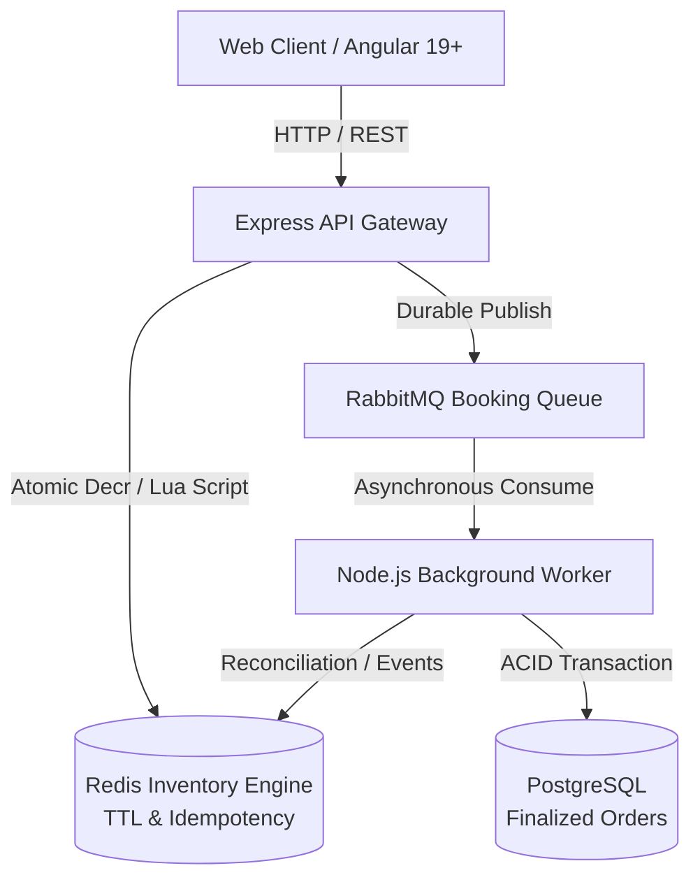

# DropShield Architecture Overview

DropShield is a distributed, high-concurrency event ticket booking platform designed to withstand flash-crowd demand spikes (e.g., Taylor Swift / Coldplay stadium drops) without overselling, deadlocks, or system degradation.

## Core System Architecture

## System Tenets

1. **Memory-First Fast-Path Allocation**:
   Incoming ticket purchase requests are atomically claimed in Redis using Lua scripts before touching PostgreSQL, absorbing 10,000+ RPS without database connection exhaustion.
2. **Asynchronous Fulfillment**:
   Once inventory is tentatively reserved with a TTL lease, a durable message is dispatched to RabbitMQ for decoupled database persistence.
3. **Strict Zero-Overselling Guarantee**:
   Guaranteed by transactional Redis Lua operations, monotonic sequence checks, and PostgreSQL conditional constraints.
4. **Idempotent Operations**:
   Every booking attempt carries a unique client-generated or server-assigned idempotency token preventing duplicate charges or bookings.

## Phase Roadmap

- **Phase 01**: Repository & monorepo setup *(Current)*
- **Phase 02**: Infrastructure setup (PostgreSQL, Redis, RabbitMQ, Docker Compose)
- **Phase 03**: Database engineering (Migrations, schema, indexes, transactional constraints)
- **Phase 04**: Redis inventory engine (Lua scripts, atomic reservations, TTL and idempotency)
- **Phase 05**: Backend processing (API intake, RabbitMQ, background workers)
- **Phase 06**: Authentication & frontend (RBAC, JWT cookies, Angular booking interface)
- **Phase 07**: Reliability engineering (Retries, recovery, failure injection and reconciliation)
- **Phase 08**: Performance engineering (k6, 10K+ RPS experiments, Prometheus and Grafana)
