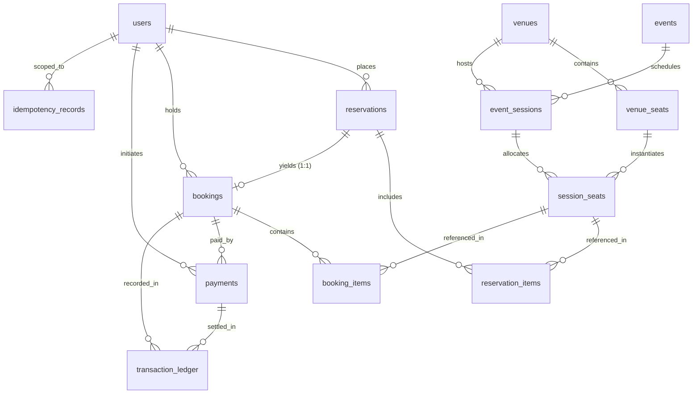
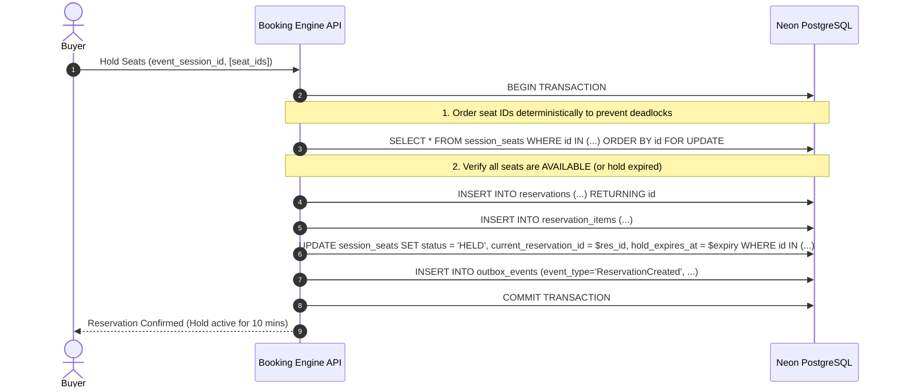

# DropShield Database Design Specification

## 1. Architecture Overview

DropShield is a distributed, high-concurrency event ticketing engine.
The database layer uses **Neon Serverless PostgreSQL (PostgreSQL 16+)** with a dual connection architecture:
- **`DATABASE_URL`**: Pooled connection string (`-pooler.neon.tech`) used by the application runtime for normal transactions, reads, and connection pooling.
- **`DIRECT_DATABASE_URL`**: Direct unpooled connection string (`.neon.tech`) used for database schema migrations and transactions requiring session-level locks like `pg_advisory_lock`.

All monetary figures are stored in **minor currency units** (e.g. paise for INR, cents for USD) as `BIGINT`. No floating-point types (`FLOAT`, `DOUBLE`) are ever used for monetary calculations.
All timestamps are stored in UTC using `TIMESTAMPTZ`.

---

## 2. Entity-Relationship (ER) Diagram



---

## 3. Database Tables & Key Constraints

### A. Core Master Data
1. **`users`**:
   - `id UUID PRIMARY KEY DEFAULT gen_random_uuid()`
   - `name VARCHAR(255)`, `email VARCHAR(255)`, `password_hash VARCHAR(255)`, `role VARCHAR(50)`
   - **Constraints**:
     - `chk_users_role`: `role IN ('buyer', 'admin')`
     - `uq_users_normalized_email`: Unique index on `LOWER(email)`

2. **`venues`**:
   - `id UUID PRIMARY KEY`, `name`, `address`, `city`, `state`, `country`, timestamps.

3. **`venue_seats`**:
   - Represents physical venue seating capacity.
   - `venue_id REFERENCES venues(id) ON DELETE CASCADE`
   - `section`, `row_label`, `seat_number`, `seat_type` (`STANDARD`, `VIP`)
   - **Constraint**: `uq_venue_seats_physical_seat UNIQUE (venue_id, section, row_label, seat_number)`

4. **`events`**:
   - `title`, `description`, `category`, `status` (`DRAFT`, `PUBLISHED`, `ARCHIVED`, `CANCELLED`)

5. **`event_sessions`**:
   - Scheduled occurrence of an event at a venue.
   - `event_id REFERENCES events(id)`, `venue_id REFERENCES venues(id)`
   - `starts_at`, `ends_at`
   - **Constraint**: `chk_event_sessions_time_range CHECK (ends_at > starts_at)`

---

### B. authorative Inventory & State Management
6. **`session_seats` (The authoritative per-session inventory table)**:
   - `event_session_id REFERENCES event_sessions(id) ON DELETE CASCADE`
   - `venue_seat_id REFERENCES venue_seats(id) ON DELETE RESTRICT`
   - `status`: `AVAILABLE`, `HELD`, `BOOKED`
   - `current_reservation_id`: Active holding reservation (nullable)
   - `current_booking_id`: Active booking (nullable)
   - `hold_expires_at`: Timestamp when the temporary hold expires (nullable)
   - `price_minor`: `BIGINT` seat price (Paise/cents)
   - **Constraints**:
     - `uq_session_seats_session_venue_seat UNIQUE (event_session_id, venue_seat_id)`
     - `chk_session_seats_price CHECK (price_minor >= 0)`
     - `chk_session_seats_state_integrity`:
       - `AVAILABLE` $\rightarrow$ `current_reservation_id IS NULL AND current_booking_id IS NULL AND hold_expires_at IS NULL`
       - `HELD` $\rightarrow$ `current_reservation_id IS NOT NULL AND hold_expires_at IS NOT NULL AND current_booking_id IS NULL`
       - `BOOKED` $\rightarrow$ `current_booking_id IS NOT NULL AND hold_expires_at IS NULL`

---

### C. Booking & Reservation History
7. **`reservations`**:
   - Temporary hold on one or more seats.
   - `status`: `PENDING`, `CONFIRMED`, `EXPIRED`, `CANCELLED`, `FAILED`
   - `expires_at`: Point in time after which hold is reclaimable.
   - **Constraint**: `uq_reservations_user_idempotency UNIQUE (user_id, idempotency_key)`

8. **`reservation_items`**:
   - Historical record of seats held under a reservation.
   - `uq_reservation_items_reservation_seat UNIQUE (reservation_id, session_seat_id)`

9. **`bookings`**:
   - Confirmed ticket purchase.
   - `reservation_id UNIQUE REFERENCES reservations(id)`: **Guarantees 1 reservation yields at most 1 booking.**
   - `status`: `CONFIRMED`, `CANCELLED`, `REFUNDED`

10. **`booking_items`**:
    - Historical record of confirmed seats under a booking.
    - `uq_booking_items_booking_seat UNIQUE (booking_id, session_seat_id)`

---

### D. Financials, Idempotency & Outbox
11. **`payments`**:
    - `booking_id`, `user_id`, `amount_minor`, `currency`, `provider`, `provider_payment_id`, `idempotency_key`, `status`
    - **Payment Lifecycle & Refund Retries**:
      - Statuses: `PENDING`, `SUCCEEDED`, `FAILED`, `REFUNDED`.
      - `uq_payments_user_idempotency UNIQUE (user_id, idempotency_key)`: Protects individual payment requests against duplicate charging on network retries.
      - `uq_payments_provider_payment_id UNIQUE (provider, provider_payment_id) WHERE provider_payment_id IS NOT NULL`: Prevents duplicate capture of the same external provider transaction.
      - `uq_payments_booking_succeeded UNIQUE (booking_id) WHERE status = 'SUCCEEDED'`: Guarantees a booking cannot have more than one active `SUCCEEDED` payment at any time.
      - **Refund & Retry Support**: When a `SUCCEEDED` payment is refunded, its status transitions to `REFUNDED`. Since the partial unique index only covers `status = 'SUCCEEDED'`, a new payment attempt for that booking (e.g. customer service re-booking or payment re-authorization) can proceed legitimately with a new idempotency key without colliding with historical refunded payments.

12. **`idempotency_records`**:
    - Protects multi-step API operations across network retries.
    - `user_id`, `operation`, `idempotency_key`, `request_hash`, `response_status`, `response_body`, `status`, `expires_at`
    - **Constraint**: `uq_idempotency_user_op_key UNIQUE (user_id, operation, idempotency_key)`

13. **`outbox_events`**:
    - Transactional Outbox pattern for publishing asynchronous domain events to RabbitMQ.
    - `aggregate_type`, `aggregate_id`, `event_type`, `payload`, `status` (`PENDING`, `PROCESSING`, `PUBLISHED`, `FAILED`), `attempts`, `available_at`
    - **Index**: Partial index on `(available_at, attempts) WHERE status IN ('PENDING', 'PROCESSING')`

14. **`transaction_ledger`**:
    - Immutable financial transaction audit ledger (preserves full transaction audit history).
    - `payment_id`, `booking_id`, `transaction_type` (`CHARGE`, `REFUND`, `REVERSAL`, `ADJUSTMENT`), `amount_minor`, `reference`
    - **Trigger**: `trg_ledger_immutable` blocks any `UPDATE`, `DELETE`, or `TRUNCATE` at the database level.

---

## 4. Concurrency & High-Concurrency Inventory Strategy

Database constraints alone cannot resolve high-frequency concurrent checkout race conditions without locking. To ensure zero double-booking under extreme load, inventory allocation transactions must execute as follows:



### Deadlock Prevention
All seat updates and `SELECT ... FOR UPDATE` row locks **MUST** sort `session_seat_id`s in ascending lexicographical order prior to acquiring locks.

### Hold Expiry & Sweeper Worker
When a buyer abandons checkout or payment fails, an asynchronous background recovery worker queries:
```sql
SELECT id FROM session_seats 
WHERE status = 'HELD' AND hold_expires_at < NOW() 
FOR UPDATE SKIP LOCKED;
```
The worker marks the expired reservation as `EXPIRED` and transitions `session_seats` status back to `AVAILABLE`.

---

## 5. Indexing Rationale

| Index Name | Table | Columns | Rationale |
|---|---|---|---|
| `uq_users_normalized_email` | `users` | `LOWER(email)` | O(1) case-insensitive authentication & duplicate email prevention. |
| `idx_venue_seats_venue_section` | `venue_seats` | `venue_id, section` | Rapid seating map rendering by venue section. |
| `idx_events_status_category` | `events` | `status, category` | Public catalog browsing filtering active published events. |
| `idx_event_sessions_event_starts` | `event_sessions` | `event_id, starts_at` | Sorting upcoming occurrences of a specific concert/match. |
| `idx_reservations_pending_expires` | `reservations` | `expires_at WHERE status = 'PENDING'` | Highly selective partial index for hold-expiry cleanup workers. |
| `idx_session_seats_session_status` | `session_seats` | `event_session_id, status` | Real-time seat availability map queries per show. |
| `idx_session_seats_held_expiry` | `session_seats` | `hold_expires_at WHERE status = 'HELD'` | Selective index scanning only currently held seats for timeout recovery. |
| `idx_bookings_user_session` | `bookings` | `user_id, event_session_id` | User ticket history and duplicate ticket verification. |
| `idx_payments_booking_status` | `payments` | `booking_id, status` | Querying settlement and refund status per booking. |
| `idx_outbox_events_pending_polling`| `outbox_events` | `available_at, attempts WHERE status IN ('PENDING', 'PROCESSING')` | High-frequency polling index for the outbox message relay worker. |

---

## 6. Migration & Seed System Commands

The project includes an advisory-locked, transactional migration runner under `backend/src/scripts/migrate.ts`:

```bash
# Apply pending migrations
npm run db:migrate

# Inspect migration status
npm run db:migrate:status

# Rollback single latest migration
npm run db:rollback

# Seed development dataset (deterministic users, venues, seats & events)
npm run db:seed
```

### Development Credentials Seeded
- **Admin**: `admin@dropshield.internal` / `Admin@123456`
- **Buyers**:
  - `alice@example.com` / `Buyer@123456`
  - `bob@example.com` / `Buyer@123456`
  - `charlie@example.com` / `Buyer@123456`
